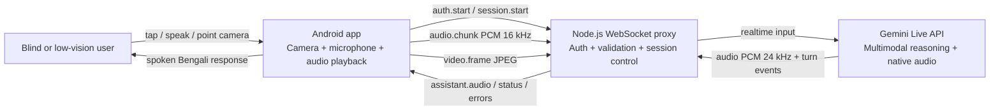
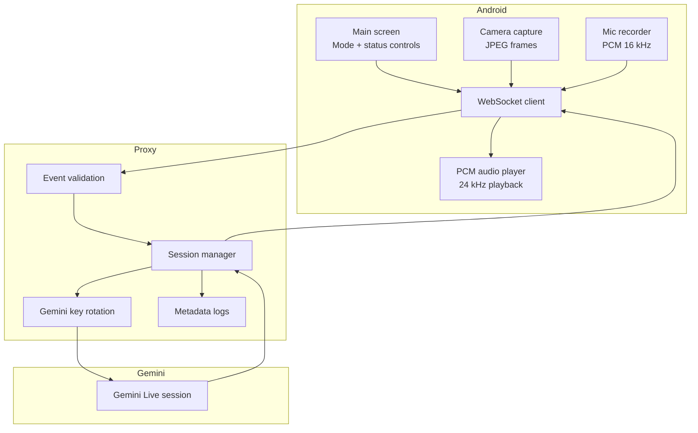

# Vision Assist MVP — Hackathon Submission Pack

## 1. Project Overview

**Vision Assist MVP** is an Android-first assistive AI prototype for blind and low-vision users. It uses the phone camera and microphone to stream real-world context to Gemini Live through a secure Node.js proxy, then plays spoken Bengali responses back on the device.

The goal is simple: a user should be able to point their phone, ask what is around them, and receive a useful spoken answer without needing to read the screen.

### Core user promise

> Tap Start Assist, point the camera, ask a question, and hear a real-time audio description of the surrounding scene.

### Current prototype status

The current build demonstrates the full Android → proxy → Gemini Live → Android loop:

- Android app connects to a local WebSocket proxy.
- Camera frames are captured and forwarded as JPEG payloads.
- Microphone audio is streamed as PCM chunks.
- Gemini Live returns native audio responses.
- Android plays Gemini PCM audio through an in-app audio player.
- The app supports three assistance modes: Navigation, Reading, and Object/Scene.

Known prototype limitations are documented in [Project Expectations](#7-project-expectations).

---

## 2. Project Walkthrough Video

### Suggested video length

**2–3 minutes**.

### Video structure

#### 0:00–0:15 — Problem

Show the phone in hand or a simple title screen.

**Narration:**

> For blind and low-vision users, understanding a changing physical environment can require another person, a separate device, or slow manual interaction. Vision Assist explores a faster path: real-time spoken visual assistance from a normal Android phone.

#### 0:15–0:35 — What the app does

Show the app home screen with the mode buttons and Start Assist button.

**Narration:**

> The user chooses a mode — Navigation, Reading, or Object and Scene — then starts an assistive session. The app streams camera and microphone input to a proxy, which connects to Gemini Live. Gemini responds with spoken audio that plays directly on the phone.

#### 0:35–1:15 — Live demo: scene understanding

Point the camera at a desk, room, doorway, object, or person-safe scene. Tap Start Assist. Let the assistant speak.

**Narration:**

> Here the phone camera is providing visual context. The assistant describes what it sees in Bengali audio. This is not a screenshot workflow — the architecture is built for ongoing camera context.

#### 1:15–1:45 — Live demo: voice question

Ask a short question such as:

- “What is in front of me now?”
- “Is there anything on the table?”
- “Can I walk forward?”

**Narration:**

> The user can also speak naturally. The microphone stream goes through the same live session, so Gemini can answer follow-up questions using both audio and visual context.

#### 1:45–2:15 — Architecture

Show the architecture diagram from this document or a slide version of it.

**Narration:**

> The app does not store API keys on the phone. A Node.js proxy owns Gemini credentials, validates app events, manages the Gemini Live session, and forwards safe events back to Android.

#### 2:15–2:45 — Impact and future

Show a user holding the phone in a real environment.

**Narration:**

> This prototype is not a finished accessibility product yet, but it proves the core loop: phone sensors, live multimodal AI, and spoken assistance. With more reliability work, privacy controls, and user testing, it can become a practical assistant for navigation, reading, and daily scene awareness.

### Recommended final caption

> Vision Assist MVP — real-time AI visual assistance on Android using Gemini Live.

---

## 3. Screenshots and UI Previews

Use these screenshots in the submission page, pitch deck, or README.

### Required screenshot set

| # | Screenshot | Purpose |
|---|---|---|
| 1 | App home screen | Shows app identity, mode choices, and Start Assist action. |
| 2 | Object/Scene mode selected | Shows the main visual-description workflow. |
| 3 | Active session status | Shows that the app is connected and listening. |
| 4 | Camera preview during session | Shows real-world use. Avoid private or sensitive scenes. |
| 5 | Assistant response state | Shows spoken response or transcript/status feedback. |
| 6 | Error state | Shows graceful handling when proxy/session fails. |

### Suggested UI preview captions

- **Mode selection:** Choose Navigation, Reading, or Object/Scene depending on the user’s need.
- **Start Assist:** Opens a live Gemini session through the proxy.
- **Live camera context:** The phone camera provides visual context for spoken answers.
- **Voice interaction:** The user can ask follow-up questions without typing.
- **Accessible-first interaction:** The interface is designed around large controls and spoken feedback.

### Visual capture tips

- Use a clean, high-contrast scene.
- Avoid private faces, addresses, documents, or API keys.
- Record audio separately if phone capture does not include internal audio.
- Include one screenshot of a failure state; judges value honest reliability design.

---

## 4. Architecture Diagrams

### System architecture



### Runtime event flow

```mermaid
sequenceDiagram
    participant U as User
    participant A as Android App
    participant P as Proxy
    participant G as Gemini Live

    U->>A: Tap Start Assist
    A->>P: auth.start
    A->>P: session.start(mode)
    P->>G: Open Gemini Live session
    G-->>P: setupComplete
    P-->>A: session.ready

    loop Active session
        A->>P: video.frame(image/jpeg)
        A->>P: audio.chunk(audio/pcm;rate=16000)
        P->>G: realtimeInput video/audio
        G-->>P: assistant audio chunks
        P-->>A: assistant.audio(audio/pcm;rate=24000)
        A-->>U: Plays spoken response
    end

    U->>A: Stop session
    A->>P: session.end
    P->>G: Close live session
```

### Component responsibilities



---

## 5. API Documentation

The Android app communicates with the proxy over WebSocket.

### Transport

- Protocol: WebSocket
- Default local port: `18787`
- Authentication: first message must be `auth.start` with a development token
- Payload format: JSON events
- Media payloads: base64-encoded audio or image data

### Android → Proxy events

#### `auth.start`

Authenticates the Android app connection.

```json
{
  "type": "auth.start",
  "devToken": "<development-token>",
  "appVersion": "1.0-debug"
}
```

#### `session.start`

Starts a Gemini Live session in one of the app modes.

```json
{
  "type": "session.start",
  "mode": "object"
}
```

Allowed modes: `navigation`, `reading`, `object`.

#### `mode.update`

Changes the active assistance mode.

```json
{
  "type": "mode.update",
  "mode": "navigation"
}
```

#### `audio.chunk`

Streams microphone audio to the live session.

```json
{
  "type": "audio.chunk",
  "mimeType": "audio/pcm;rate=16000",
  "dataBase64": "<base64-pcm-audio>",
  "timestampMs": 1710000000000
}
```

#### `video.frame`

Sends a camera frame to the live session.

```json
{
  "type": "video.frame",
  "mimeType": "image/jpeg",
  "dataBase64": "<base64-jpeg>",
  "timestampMs": 1710000000000
}
```

#### `text.input`

Sends text input to Gemini. Useful for testing or fallback interaction.

```json
{
  "type": "text.input",
  "text": "What is in front of me?"
}
```

#### `session.end`

Closes the active session.

```json
{
  "type": "session.end"
}
```

#### `ping`

Health-check event.

```json
{
  "type": "ping",
  "timestampMs": 1710000000000
}
```

### Proxy → Android events

#### `session.ready`

Confirms that the Gemini session is ready.

```json
{
  "type": "session.ready",
  "sessionId": "<uuid>",
  "mode": "object"
}
```

#### `assistant.audio`

Returns native Gemini audio for playback.

```json
{
  "type": "assistant.audio",
  "mimeType": "audio/pcm;rate=24000",
  "dataBase64": "<base64-pcm-audio>"
}
```

#### `assistant.text`

Returns text/transcription output when text responses are enabled or available.

```json
{
  "type": "assistant.text",
  "text": "There is a chair in front of you.",
  "final": true
}
```

#### `assistant.turn_complete`

Indicates that the model has completed its current turn.

```json
{
  "type": "assistant.turn_complete"
}
```

#### `mode.confirmed`

Confirms mode update.

```json
{
  "type": "mode.confirmed",
  "mode": "reading"
}
```

#### `status.update`

Reports session lifecycle state.

```json
{
  "type": "status.update",
  "state": "active"
}
```

Allowed states: `opening`, `active`, `cooldown`, `closed`.

#### `error`

Reports recoverable or terminal failures.

```json
{
  "type": "error",
  "code": "session_error",
  "message": "Failed to handle Android event"
}
```

#### `pong`

Response to ping.

```json
{
  "type": "pong",
  "timestampMs": 1710000000000
}
```

### Proxy configuration

| Variable | Purpose |
|---|---|
| `PORT` | WebSocket proxy port. Defaults to `18787`. |
| `SESSION_IDLE_MS` | Idle timeout before closing a Gemini session. Defaults to 60 seconds. |
| `APP_DEV_TOKEN` | Development token required from Android. |
| `GEMINI_API_KEY` | Single Gemini API key. |
| `GEMINI_API_KEYS` | Comma-separated Gemini API keys for rotation. |
| `GEMINI_LIVE_MODEL` | Gemini Live model name. Defaults to Gemini 3.1 Flash Live preview. |
| `GEMINI_RESPONSE_MODALITY` | `AUDIO` or `TEXT`; prototype uses `AUDIO`. |

### Security and privacy notes

- Gemini API keys stay on the proxy, not in the Android app.
- The proxy validates all Android events before routing them.
- Media payloads should not be stored by default.
- Logs should contain metadata only, not raw API keys, camera frames, microphone audio, or development tokens.

---

## 6. Scalability and Future Roadmap

### Current MVP architecture

The current system is optimized for hackathon prototype validation:

- One Android app
- One WebSocket proxy
- One Gemini Live session per connected user
- Metadata logging for debugging
- Local development deployment

### Scalability path

| Area | MVP | Scalable version |
|---|---|---|
| Proxy runtime | Single Node.js process | Horizontally scaled WebSocket service |
| Session ownership | In-memory session manager | Sticky sessions or external session registry |
| Secrets | Local environment variables | Managed secret store and rotation policy |
| Observability | Metadata logs | Structured logs, metrics, traces, session diagnostics |
| Model access | Gemini API key rotation | Quotas, per-user limits, fallback models |
| Media handling | No persisted media | Explicit consent, retention policy, encrypted storage if needed |
| Authentication | Development token | Real user auth or device-bound credentials |
| Deployment | Local machine | Cloud service close to target users |

### Roadmap

#### Phase 1 — Reliable prototype

- Stabilize camera frame streaming.
- Stabilize microphone echo suppression.
- Preserve barge-in without self-reply loops.
- Add stronger failure states when Gemini or network access fails.
- Complete real-device validation.

#### Phase 2 — Accessibility polish

- Improve TalkBack labels and focus order.
- Add haptic cues for session start, response start, and errors.
- Add hardware button or accessibility shortcut launch path.
- Add simple voice-first mode switching.

#### Phase 3 — Real-world safety

- Add uncertainty-first response policy for navigation.
- Add obstacle and hazard phrasing that avoids overconfidence.
- Add low-light and blocked-camera detection.
- Add privacy warnings and safe default logging.

#### Phase 4 — Production architecture

- Deploy proxy to a managed environment.
- Add user/device auth.
- Add usage limits and cost controls.
- Add observability dashboards.
- Add fallback behavior when Gemini Live is unavailable.

#### Phase 5 — User testing and partnerships

- Test with blind and low-vision users.
- Compare Navigation, Reading, and Object/Scene workflows.
- Partner with accessibility groups for feedback.
- Prepare a safety and privacy review before public release.

---

## 7. Business or Impact Analysis

### Problem

Blind and low-vision users often need immediate visual context: what is in front of them, whether a path is clear, what an object is, or what text says. Existing tools can be powerful, but many workflows are still slow, screen-heavy, or not optimized for fast spoken interaction.

### Target users

- Blind users who want quick scene awareness.
- Low-vision users who need spoken descriptions.
- Users in unfamiliar indoor spaces.
- Users who need lightweight reading or object identification help.
- Caregivers, accessibility testers, and assistive technology researchers.

### Impact thesis

Vision Assist can reduce friction in everyday visual tasks by turning a normal Android phone into a live audio assistant. The biggest value is not perfect object recognition; it is fast, available, spoken context that helps a user decide what to do next.

### Differentiators

- **Voice-first interaction:** The user does not need to type or read the screen.
- **Live multimodal loop:** Camera and microphone context can be handled together.
- **Bengali audio support:** The prototype targets spoken Bengali responses, expanding usefulness beyond English-only demos.
- **Proxy security boundary:** API credentials are not embedded in the app.
- **Mode-specific prompts:** Navigation, Reading, and Object/Scene modes shape responses for different real-world needs.

### Risks and responsible-use concerns

| Risk | Mitigation direction |
|---|---|
| Overconfident navigation advice | Use uncertainty-first prompts and avoid safety-critical guarantees. |
| Privacy exposure from camera/mic | Avoid media retention, add clear consent and local indicators. |
| Network or model outage | Provide clear user-facing failure states and stop sensors on failure. |
| Latency | Tune frame rate, audio chunking, and proxy location. |
| Echo/self-reply loops | Suppress microphone input during assistant playback while preserving barge-in. |

### Possible adoption model

- Hackathon prototype → user-tested pilot.
- Pilot with accessibility organizations or university disability services.
- Freemium or sponsored model for individuals.
- Institutional licensing for accessibility labs, schools, or assistive service providers.

---

## 8. Project Expectations

### What judges should expect from the MVP

This is a working prototype, not a finished medical or safety-certified assistive product.

Expected strengths:

- Demonstrates the full live AI assistance architecture.
- Shows Android camera, microphone, proxy, Gemini Live, and audio playback integration.
- Provides a realistic foundation for assistive scene description.
- Uses a safer proxy pattern instead of putting API keys on device.

Expected limitations:

- Live behavior depends on Gemini API access, quotas, and model availability.
- Real-time camera streaming and barge-in behavior are still being tuned.
- The prototype should not be trusted for safety-critical navigation.
- The app currently targets local or development deployment.
- Privacy, consent, retention, and production auth need hardening before real launch.

### Evaluation criteria mapping

| Expectation | How this project addresses it |
|---|---|
| Technical ambition | Combines Android sensors, WebSocket proxying, Gemini Live, native audio playback, and multimodal interaction. |
| User value | Targets real accessibility needs: scene awareness, reading help, and spoken interaction. |
| Demo clarity | Can be shown with a phone, camera movement, and voice questions. |
| Architecture quality | Separates mobile app from model credentials and session control. |
| Future potential | Clear path toward accessibility polish, production deployment, and user testing. |

### Final submission summary

Vision Assist MVP proves that a standard Android phone can become a real-time spoken visual assistant by combining camera input, microphone input, Gemini Live, and a secure proxy architecture. The current prototype demonstrates the hardest core loop and provides a clear roadmap toward a reliable accessibility tool.
